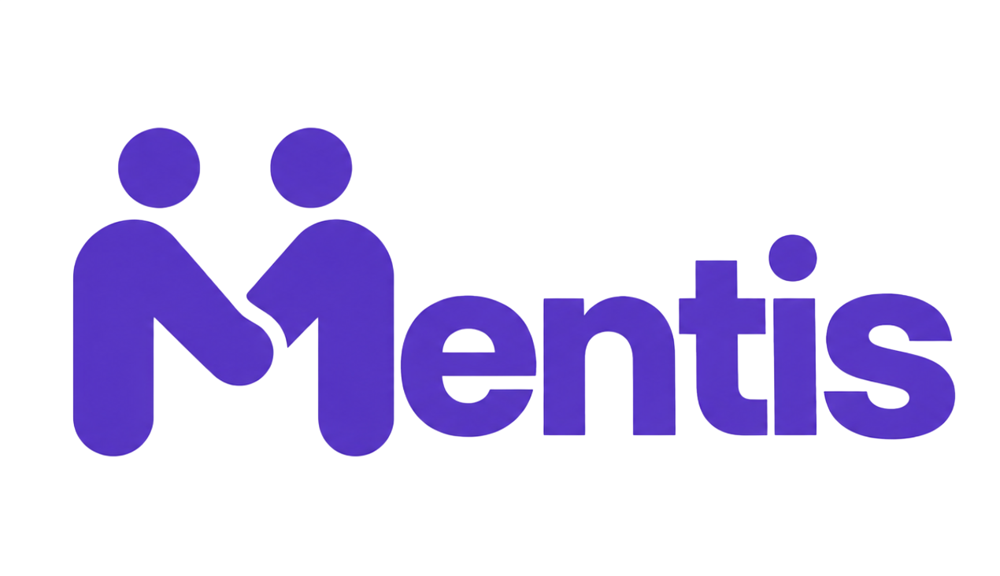

# __ENG4021 - Projeto de Software__
## Desenvolver um site relacionado a educação.
Integrantes: _Alexandre, Amanda Estevão, Beatriz Cunha, Beatriz Feijo, Pedro Cavalcante e Matheus Loureiro_




## Sumário

- [Sobre o projeto](#sobre-o-projeto)
- [Funcionalidades](#funcionalidades)
- [Telas](#telas)
- [Tecnologias](#tecnologias)
- [Como rodar o projeto](#como-rodar-o-projeto)
- [Dados de teste](#dados-de-teste)
- [Estrutura do repositório](#estrutura-do-repositório)
- [Documentação do projeto](#documentação-do-projeto)
- [Como contribuir](#como-contribuir)
- [Problemas e soluções](#problemas-e-soluções)

## Sobre o projeto

O Mentis é um site que conecta estudantes do ensino fundamental e médio a professores particulares.

A ideia veio da nossa pesquisa com estudantes: a maioria só conhece professores por indicação e acaba aceitando o preço cobrado por falta de opção. Do outro lado, muitos professores bons não têm um lugar confiável para divulgar suas aulas e seus materiais.

No site, o estudante procura professores por disciplina, compara preço e avaliações e acompanha suas aulas. O professor monta um perfil, publica materiais de estudo e informa os horários em que pode dar aula.

O nosso objetivo é facilitar o acesso à educação, aproximando quem quer aprender de quem sabe ensinar.

## Funcionalidades

- Página principal com busca de professores por nome ou disciplina
- Cadastro e login como estudante ou como professor
- Perfil do professor com formação, valor da hora-aula, materiais, avaliações e horários disponíveis
- Ambiente do aluno com agenda, disciplinas e avaliações feitas
- Mensagens entre aluno e professor
- Página de materiais de estudo (PDF, vídeo, link e lista de exercícios)
- Avaliação das aulas e do site
- Edição do perfil, incluindo foto
- Página de usuários, só para a equipe administrativa

## Telas

As telas foram desenhadas no Figma antes da programação. Algumas delas:

Página principal:


Login:


Perfil do estudante:


O fluxo entre as telas de acesso está em [fluxograma.png](documentos/Telas/fluxograma.png).

## Tecnologias

- Python e Django, para o servidor e o banco de dados
- SQLite, banco de dados usado no desenvolvimento
- HTML, CSS e JavaScript, para as páginas
- Figma, para o desenho das telas
- GitHub e Codespaces, para o código e o ambiente de desenvolvimento
- Kanban do GitHub, para organizar as tarefas de cada sprint

## Como rodar o projeto

> [!TIP]
> O jeito mais fácil é usar o GitHub Codespaces: clique em **Code → Codespaces → Create codespace on main** e siga os passos abaixo no terminal.

1. Entre na pasta do site:

```bash
cd Site
```

2. Instale as dependências:

```bash
pip install -r requirements.txt
```

3. Libere o endereço do Codespace (só é necessário no Codespace):

```bash
export DJANGO_ALLOWED_HOSTS=".app.github.dev,localhost,127.0.0.1"
export DJANGO_CSRF_TRUSTED_ORIGINS="https://$CODESPACE_NAME-8000.app.github.dev"
```

4. Crie as tabelas do banco de dados:

```bash
python manage.py migrate
```

5. Inicie o servidor:

```bash
python manage.py runserver 0.0.0.0:8000
```

6. Abra o endereço que o Codespace mostrar para a porta **8000**.

> [!NOTE]
> O passo 3 precisa ser repetido toda vez que você abrir um terminal novo.

Para rodar os testes automáticos:

```bash
python manage.py test MentisDjango
```

## Dados de teste

Para ver o site com conteúdo, dá para preencher o banco com dados fictícios. Os comandos só acrescentam dados e podem ser rodados mais de uma vez sem duplicar nada.

```bash
python manage.py popular_banco
python manage.py popular_professores
```

O primeiro cria disciplinas, professores, alunos, aulas, pagamentos e avaliações. O segundo cria professores com perfil completo, horários e materiais.

Para entrar na área administrativa (`/admin`), crie um usuário administrador:

```bash
python manage.py createsuperuser
```

## Estrutura do repositório

```text
Mentis/
├── Site/                  → site em Django (é aqui que o projeto roda)
│   ├── config/            → configurações (settings.py e urls.py)
│   ├── MentisDjango/      → aplicativo do Mentis
│   │   ├── models.py      → tabelas do banco de dados
│   │   ├── views*.py      → lógica das páginas
│   │   ├── templates/     → páginas HTML
│   │   ├── static/        → CSS, JavaScript e imagens
│   │   └── management/    → comandos para popular o banco
│   ├── manage.py
│   └── requirements.txt
├── documentos/            → pesquisas, escopo, requisitos, telas e análises
├── reuniões/              → atas das reuniões
├── calculadora/           → atividade da Sprint 1
└── core/, mentis_project/ → primeira versão do banco de professores
```

## Documentação do projeto

Os documentos que fizemos antes e durante o desenvolvimento estão na pasta `documentos`:

- [Escopo do projeto](documentos/Concep%C3%A7%C3%A3o%20do%20Produto/Escopo%20do%20Mentis.docx)
- [Definição da proposta](documentos/Concep%C3%A7%C3%A3o%20do%20Produto/Definic%CC%A7a%CC%83o%20da%20proposta.docx)
- [Requisitos do sistema](documentos/Concep%C3%A7%C3%A3o%20do%20Produto/Requisitos%20do%20Sistema%20-%20ENG4021%20-%20Google%20Docs.pdf)
- [Diagrama UML](documentos/Concep%C3%A7%C3%A3o%20do%20Produto/diagrama_uml_plataforma_aulas.pdf)
- [Público-alvo](documentos/An%C3%A1lises/DocumentoPublicoAlvo.pdf)
- [Concorrentes](documentos/An%C3%A1lises/Concorrentes.pdf)
- [Definição do problema e as 20 hipóteses](documentos/An%C3%A1lises/Defini%C3%A7%C3%A3o%20do%20problema%20e%20as%2020%20hip%C3%B3teses.pdf)
- [Atas das reuniões](reuni%C3%B5es)

## Como contribuir

Cada integrante trabalha no seu próprio fork e envia as mudanças por pull request:

1. Faça um fork deste repositório e mantenha ele atualizado com **Sync fork**.
2. Abra um Codespace no seu fork.
3. Crie ou altere os arquivos da sua tarefa.
4. Envie para o seu fork:

```bash
git add <arquivos da tarefa>
git commit -m "Sprint X: descrição da tarefa"
git push
```

5. No GitHub, clique em **Contribute → Open pull request** para enviar ao repositório principal.

> [!IMPORTANT]
> Antes de fazer merge, confira se o pull request mostra **"No conflicts with base branch"**. Se aparecerem conflitos, resolva antes e confira se não sobraram linhas com `<<<<<<<`, `=======` ou `>>>>>>>` nos arquivos.

## Problemas e soluções

**`No module named django`**
As dependências não foram instaladas. Rode `pip install -r requirements.txt` dentro da pasta `Site`.

**Erro 400 (Bad Request) ao abrir o site no Codespace**
O endereço do Codespace não foi liberado. Rode os comandos do passo 3 de [Como rodar o projeto](#como-rodar-o-projeto) e reinicie o servidor.

**Erro 403 (CSRF) ao fazer login ou cadastro no Codespace**
Mesmo motivo: falta o `DJANGO_CSRF_TRUSTED_ORIGINS` do passo 3.

**`no such table` ao abrir uma página**
O banco ainda não tem as tabelas. Rode `python manage.py migrate`.

**O link do Codespace não abre para outra pessoa**
Na aba **Portas** do Codespace, clique com o botão direito na porta 8000 e mude a visibilidade para **Public**.
